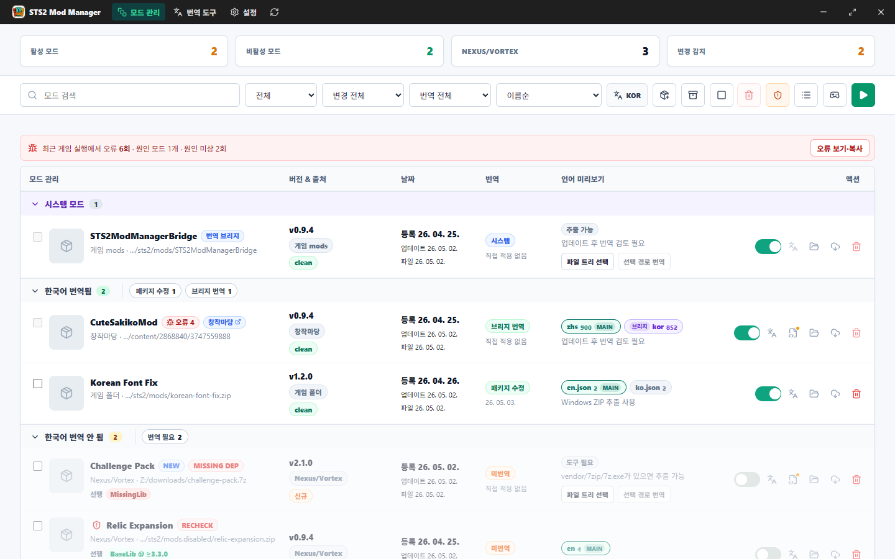
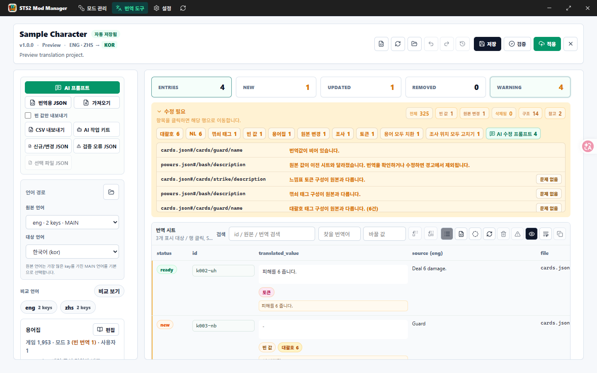

# STS2 Mod Translation Manager

Slay the Spire 2 모드 관리와 모드 번역을 돕는 Windows 데스크톱 도구입니다.

- **모드 관리:** 모드를 켜고 끄고, 업데이트와 오류를 확인하고, 게임을 실행합니다. Steam 창작마당 모드도 함께 다룹니다.
- **번역 도구:** 모드의 언어 파일과 DLL 문자열을 시트로 번역하고 검증합니다. 웹 AI 채팅용 프롬프트를 만들고, 받은 답변을 붙여넣어 적용합니다.
- **번역 브리지:** 프로그램과 함께 설치되는 게임 안 모드입니다. 원본 모드 파일을 건드리지 않고 게임 실행 중에 번역을 적용합니다. 게임 안에서 F8로 번역을 바로 고칠 수 있습니다.

현재는 **한국어 번역 작업을 중심으로** 다듬고 검증했습니다. 다른 언어 선택 UI가 일부 남아 있지만, 안정적으로 지원하는 목표는 한국어입니다.

> 이 프로젝트는 **100% 바이브 코딩으로 작성**되었습니다. 사람이 방향을 잡고, AI와 대화하며 설계, 구현, 수정, 정리를 반복한 실험적 프로젝트입니다.

## 스크린샷

> 아래 스크린샷은 이전 버전 화면입니다. 지금 버튼 배치와 다를 수 있습니다.





## 설치

1. [Releases](https://github.com/trans-35960/STS2-Mod-Translation-Manager/releases)에서 최신 버전을 받습니다.
   - **설치 파일:** 일반 프로그램처럼 설치합니다.
   - **portable ZIP** (`sts2-mod-manager-<버전>-windows-x64-portable.zip`): 압축을 풀고 `STS2 Mod Manager.exe`를 실행합니다. `vendor` 폴더는 실행 파일 옆에 그대로 두세요. 설정, 백업, 번역 작업 파일도 이 폴더 안에 저장됩니다.
2. 처음 실행하면 게임 폴더, 세이브 폴더, 게임 로그를 자동으로 찾습니다. 찾지 못하면 **설정**에서 직접 지정합니다.
3. 번역 브리지 모드는 프로그램이 게임의 `mods` 폴더에 자동으로 설치합니다. 새 버전이 나오면 프로그램이 브리지도 갱신합니다.

## 모드 관리

### 목록 보기

- **상세 보기 / 심플 보기**를 전환합니다. 심플 보기는 섹션 칩으로 필터를 걸 수 있습니다.
- 필터: 활성 상태, 변경 상태(신규, 업데이트됨, 변경 없음), 번역 상태(번역됨, 번역 필요, 번역 모드 꺼짐, 언어 파일 없음).
- 정렬: 이름, 등록일, 업데이트, 파일 수정, 번역 적용, 활성 우선, 변경 우선, 출처, 버전.
- 변경 감지는 **지난 게임 실행 때와 비교**합니다. 모드 버전이 바뀌면 자동으로 표시합니다.
- 번역 모드(다른 모드를 번역하는 별도 모드)는 원본 모드 아래에 접어서 보여 줍니다.

### Steam 창작마당

- 창작마당 모드는 창작마당 제목과 썸네일을 함께 보여 줍니다. 썸네일에 마우스를 올리면 크게 보입니다.
- 창작마당 페이지를 바로 열 수 있습니다.
- **창작마당에서 구독 해제**로 Steam 구독을 해제합니다.
- 지금 Steam 브랜치(정식 `public` / 베타 `public-beta`)에서 지원하지 않는 모드는 경고를 표시합니다.

### 모드 추가와 업데이트

- **모드 불러오기:** 폴더, 압축 파일(ZIP, 7Z, RAR), Nexus/Vortex 다운로드 폴더에서 불러옵니다.
- 파일을 창에 끌어다 놓아도 됩니다. 기존 모드와 이름이나 버전이 비슷하면, 업데이트로 처리할지 별개 모드로 등록할지 고르게 합니다.
- **업데이트 확인**으로 Nexus/Vortex 다운로드의 새 버전을 찾습니다.

### 게임 실행

- **현재 모드 실행:** 지금 켜 둔 모드로 게임을 실행합니다.
- **바닐라 실행:** 모드를 끈 안전한 상태로 게임을 실행합니다.
- 실행 전에 세이브를 백업합니다. 또 켜진 모드가 현재 게임 버전과 맞는지 검사합니다. 이 검사는 DLL에 들어 있는 참조만 봅니다. 경고가 없어도 리플렉션으로 이름을 찾는 코드는 튕길 수 있습니다.
- 다른 모드가 필요한 모드에 그 모드가 없으면 **선행 모드 확인 필요**를 표시합니다.

### 게임 오류

- 최근 게임 로그에서 오류를 읽어 **원인 모드별로 나눠** 보여 줍니다. 원인 모드를 특정하지 못한 오류는 따로 모읍니다.
- **모두 복사**로 게임 버전, Steam 브랜치, 모드 정보가 들어간 오류 보고를 복사합니다. 모드 제작자에게 그대로 보낼 수 있습니다.

### 프리셋과 삭제 복구

- **프리셋:** 지금 켜 둔 모드 구성을 이름을 붙여 저장하고, 나중에 다시 적용합니다. ZIP으로 내보내고 불러올 수 있습니다.
- 삭제한 모드는 바로 지우지 않고 보관합니다. **설정 > 최근 삭제**에서 복원합니다.

## 번역 도구

모드 목록에서 **번역** 버튼을 누르거나, 번역 탭의 **번역 시작**에서 모드를 고릅니다. 모드의 언어 파일을 추출해 번역 시트를 만듭니다. PCK 안에 있는 파일도 추출합니다.

### 번역 시트

- 원문과 번역을 표로 보면서 편집합니다. 긴 시트도 가상 스크롤로 빠르게 그립니다.
- 변경은 **자동 저장**됩니다. `Ctrl+S`로 바로 저장할 수 있습니다.
- `Ctrl+Z` / `Ctrl+Y`로 되돌리기와 다시 하기를 합니다. **작업 시작 시점으로 되돌리기**도 있습니다.
- **원본 언어**는 key가 가장 많은 언어를 기본으로 고릅니다. 모드마다 마지막에 고른 원본 언어를 기억합니다.
- 원본 언어가 달라도 같은 key의 번역은 공유합니다.
- **비교 언어**를 켜면 다른 언어의 원문을 옆에 함께 봅니다.
- 모드가 업데이트되어 원문이 바뀐 항목은 **이전 원문과 단어 단위로 비교**해서 보여 줍니다.
- 검색과 치환: id, 원문, 번역을 검색하고, 선택 항목, 현재 표시 항목, 전체 시트 단위로 치환합니다.

### 검증

**검증**을 누르면 원문과 구조가 어긋난 번역을 찾습니다. 항목을 누르면 해당 행으로 이동합니다.

- 검사 항목: 빈 값, 원본 변경, 삭제됨, 줄바꿈, 꺾쇠 태그, 대괄호, 플레이스홀더, 토큰, 숫자 불일치, 용어집, 조사.
- **용어 모두 치환:** 다르게 번역된 강조 용어를 용어집 번역어로 바꾸고, 뒤에 오는 조사를 받침에 맞춥니다.
- **조사 위치 모두 고치기:** 강조 태그 안에 들어간 조사를 태그 밖으로 옮깁니다.
- **문제 없음 표시:** 확인해 보니 문제가 없는 경고(오탐)를 목록에서 뺍니다. 원본이나 번역이 바뀌면 다시 검사합니다.
- **경고 AI 수정:** 남은 경고를 AI 수정 프롬프트로 만듭니다. 보낼 문제 종류를 고를 수 있습니다. AI 답변은 바로 덮어쓰지 않습니다. 바뀐 부분과 다시 검증한 결과를 비교한 뒤 허가합니다.

### AI 프롬프트

웹 AI 채팅(ChatGPT, Gemini, Claude 등)에 붙여넣을 번역 프롬프트를 만듭니다. 입력한 설정은 모드마다 자동 저장됩니다.

1. **설정:** 모드 배경(컨셉, 캐릭터, 세계관), 어조, 추가 지시를 적습니다.
   - 어조: 게임 공식 번역체(합니다체), 부드러운 해요체, 대사는 반말·설명은 합니다체, 원문 어조 유지.
2. **용어:** 원문에서 용어 후보(강조, 이름, 대문자)를 기계로 뽑습니다. 번역어를 정해 용어에 추가하면, 본문 파트마다 용어집으로 들어가고 검증에도 쓰입니다.
3. **본문 파트:** 번역할 항목을 파트로 나눕니다. 코드 이름, 로그, 경로, 정규식은 빼고 번역할 문장만 보냅니다. 원문이 바뀐 항목은 기존 번역과 이전 원문을 함께 보내 고쳐 달라고 합니다.

- 파트를 복사해 AI에 보내고, 받은 답변을 그대로 붙여넣으면(`Ctrl+V`) 시트에 적용됩니다. 답변에 설명이나 라벨이 섞여 있어도 JSON만 골라냅니다.
- 기존 번역과 다른 값은 덮어쓰지 않고 **충돌 후보**로 남깁니다. 비교한 뒤 허가합니다.
- **모두 내보내기:**
  - TXT: 파트로 나누지 않은 전체 프롬프트 하나를 파일 하나로 저장합니다.
  - PDF: 파트마다 작은 글씨로 페이지를 채운 PDF를 만듭니다. Gemini처럼 페이지 단위로 계산하는 AI에 파일로 올리면 입력 토큰이 줄 수 있습니다.

### 용어집

- **이 모드 용어**와 **사용자 용어**를 따로 관리합니다. 표 또는 JSON으로 편집하고, 번역어가 빈 용어만 골라 볼 수 있습니다.
- 게임 PCK(`SlayTheSpire2.pck`)를 찾으면, 원문의 `[gold]` 강조 용어를 **게임 공식 번역**과 비교해 검사합니다.

### 그 밖의 작업 도구

- **CSV/JSON 내보내기와 가져오기:** 외부에서 번역한 파일을 id로 매칭해 가져옵니다.
- **AI 작업 키트:** 번역 JSON, 규칙 안내, 용어집 파일을 한 번에 내보냅니다.
- **남은 원문 검사:** 번역 후에도 원문이 남는 위치(DLL 코드 문자열, localization 밖 리소스, 번역 모드)를 찾습니다.

## 번역 적용

### 번역 저장/적용

**번역 저장/적용**을 누르면 **번역 브리지**를 통해 게임에 적용합니다.

- 모드의 `localization/` 언어 파일과 DLL 문자열은 브리지가 게임 실행 중에 적용합니다. 원본 모드 파일은 바꾸지 않습니다.
- 처음 브리지로 적용할 때, 같은 모드에 예전에 만든 번역 패치 모드(`*_tr`)가 있으면 꺼 둡니다. 둘이 같은 문장을 적용하면 내용이 서로 어긋나기 때문입니다. 다시 켜면 그대로 둡니다.
- `localization/` 밖의 파일은 예전처럼 PCK 패치 모드를 만들어 적용합니다.

### 번역 모드로 내보내기

다른 사람에게 배포할 번역 모드(PCK)를 만듭니다. 실험적 기능입니다.

## 번역 브리지 (게임 안)

번역 브리지는 이 프로그램이 설치하고 관리하는 게임 안 모드입니다. 모드 목록에 **시스템 모드**로 표시됩니다. 브리지 번역을 쓰려면 켜 두세요.

| 키 | 동작 |
|---|---|
| `F8` | 번역 수정 패널을 열고 닫습니다. 열 때 프로그램이 방금 적용한 번역을 다시 읽습니다. |
| `Ctrl+F8` | 번역된 문장 앞에 `(#번호)`를 붙입니다. 게임 화면에서 본 문장을 패널에서 번호로 찾을 수 있습니다. |
| `Ctrl+Enter` | 패널에서 고친 번역을 저장하고 바로 적용합니다. |
| `Esc` | 패널을 닫습니다. |

- **게임 안 수정:** 패널에서 원문, 번역, 키로 검색해 번역을 고칩니다. 저장하면 바로 게임 화면에 반영됩니다.
- **오역 신고:** 바로 고치기 어려우면 메모와 함께 신고만 남깁니다.
- **가져오기:** 번역 도구의 **게임 안 수정 가져오기**로 게임에서 고친 값과 오역 신고를 시트로 가져옵니다. 시트와 게임 양쪽에서 바뀐 항목은 어느 쪽을 쓸지 고릅니다.

### DLL 문자열 번역

C# 코드에 직접 들어간 문자열도 번역할 수 있습니다. 모드 목록에서 **DLL 문자열 번역**을 고릅니다.

- DLL 문자열에는 화면 문장 말고도 이름, 키, 비교용 값이 섞여 있습니다. 잘못 바꾸면 **모드가 오작동하거나 게임이 튕길 수 있습니다.**
- 번역 도구는 번역할 문장만 먼저 보여 줍니다. 키, 로그, 경로, 정규식처럼 바꾸면 안 되는 항목은 적용할 때 자동으로 뺍니다. 그래도 완벽하지는 않습니다.
- 브리지를 켜고 게임을 한 번 실행하면, 코드가 각 문자열을 어떻게 쓰는지 분석해 반영합니다. 게임 화면에 실제로 나온 문자열도 표시합니다.
- 비교·검색에도 쓰이는 문자열은 화면 문장을 만드는 위치에서만 바꿉니다.
- DLL 문자열은 **게임을 다시 시작해야** 확실히 반영됩니다. F8 패널에서도 고칠 수 있습니다.
- 번역 후 게임이 이상하면 그 모드의 DLL 번역부터 의심하세요.

### 공용 폴더

프로그램과 브리지는 `%APPDATA%\STS2ModTranslationManager\shared\`를 통해 번역과 게임 안 수정을 주고받습니다. 모드 폴더 바깥에 있어서, 브리지를 다시 설치해도 번역이 지워지지 않습니다.

## 설정과 문제 해결

- **경로:** 게임 실행 파일, 게임 로그(`godot.log`), 세이브 폴더, 세이브 백업 경로.
- **세이브 백업:** 보관 기간과 최대 백업 수를 정합니다. 백업 세트를 골라 복원하거나 삭제합니다.
- **최근 삭제:** 삭제한 모드를 복원합니다. 보관 기간을 정할 수 있습니다.
- **문제 해결:** 설치, 로그, 업데이트, 번역, 의존성, 브랜치, 세이브 문제를 진단하고 자동으로 정리합니다.
  - 예: 잘못 배치된 모드 정리, 진행 중 런(`current_run.save`) 정리, 작업 캐시 정리.

## 예제 프롬프트

`sample/prompt/`에 예제 프롬프트가 있습니다. 앱의 AI 프롬프트 기능 없이 직접 작업할 때 참고하세요.

- `sts2-한국어 번역.txt`: 중국어/영어 JSON 값을 한국어로 번역할 때 쓰는 기본 프롬프트
- `sts2-한국어 번역 오류 수정.txt`: 검증 오류가 있는 한국어 번역을 구조를 지키며 고칠 때 쓰는 프롬프트

## 개발

### 필요한 도구

- Rust toolchain
- Node.js 20.19 이상, npm
- 번역 브리지 빌드: .NET SDK와 게임 설치(게임 DLL을 참조합니다)

### 구조

| 경로 | 내용 |
|---|---|
| `src/` | 핵심 로직과 CLI (Rust) |
| `src-tauri/` | Tauri 데스크톱 앱 (별도 크레이트) |
| `web/` | React 프론트엔드 |
| `bridge/` | 게임 안 번역 브리지 모드 (C#, Godot.NET.Sdk) |
| `scripts/` | 검사, 빌드, 릴리즈 스크립트 |

### 명령

```powershell
npm install
```

데스크톱 앱 개발 실행(개발 서버 포트 5180):

```powershell
npm run tauri dev
```

번역 브리지 빌드(결과는 `vendor/bridge/`에 들어갑니다):

```powershell
.\scripts\build-bridge.ps1
```

전체 검사(두 크레이트의 test/clippy, Tauri 명령 계약, 브리지 빌드, `tsc`, `vite build`):

```powershell
.\scripts\check.ps1
```

릴리즈 빌드:

```powershell
.\scripts\build-release.ps1
```

버전 올리기, 릴리즈 절차, 커밋 규칙은 [AGENTS.md](AGENTS.md)를 따릅니다.

## CLI

빌드하면 CLI 실행 파일이 `target\release\sts2_mod_manager.exe`에 생깁니다. 인자 없이 실행하면 도움말을 출력합니다.

```powershell
.\target\release\sts2_mod_manager.exe scan
.\target\release\sts2_mod_manager.exe preset list
.\target\release\sts2_mod_manager.exe translation list
.\target\release\sts2_mod_manager.exe launch status
.\target\release\sts2_mod_manager.exe tools status
```

## 주의

모드 파일과 세이브 파일을 다루는 도구입니다. 세이브와 모드를 백업한 뒤 사용하세요.

## 라이선스

MIT. 함께 배포하는 외부 도구의 라이선스는 [THIRD_PARTY_NOTICES.md](THIRD_PARTY_NOTICES.md)를 참고하세요.
